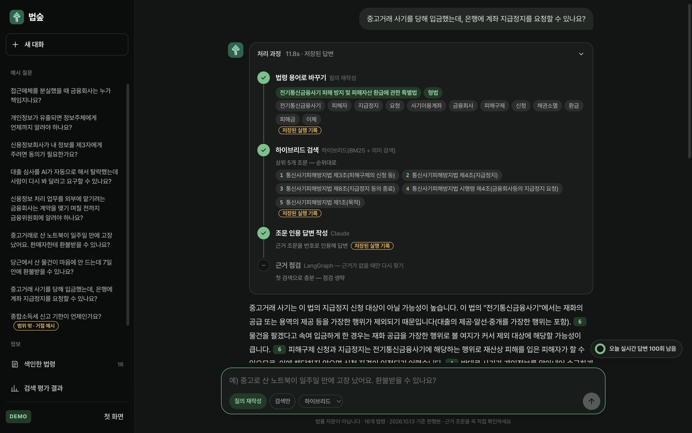
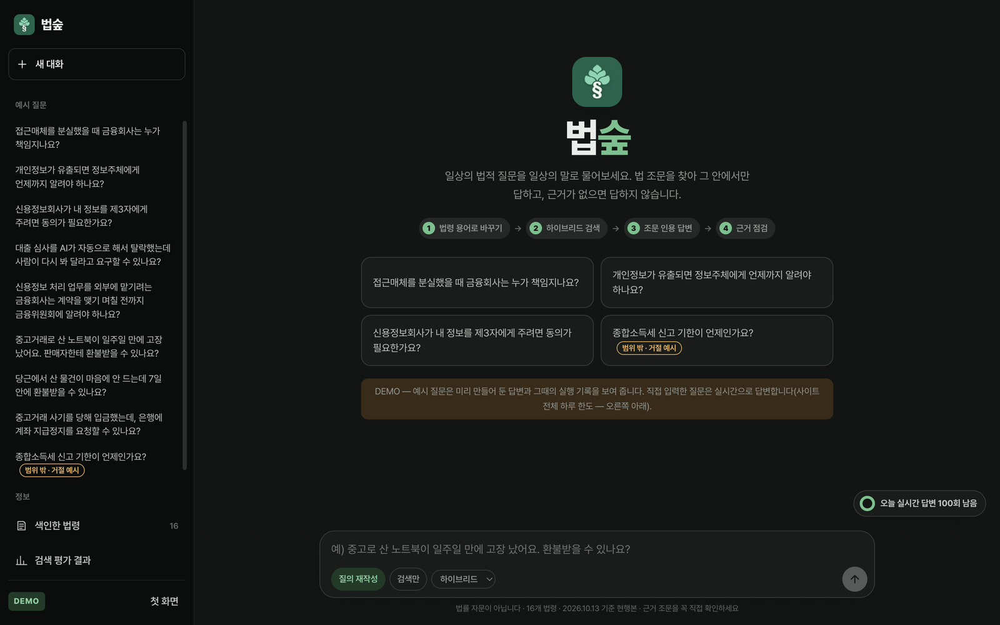
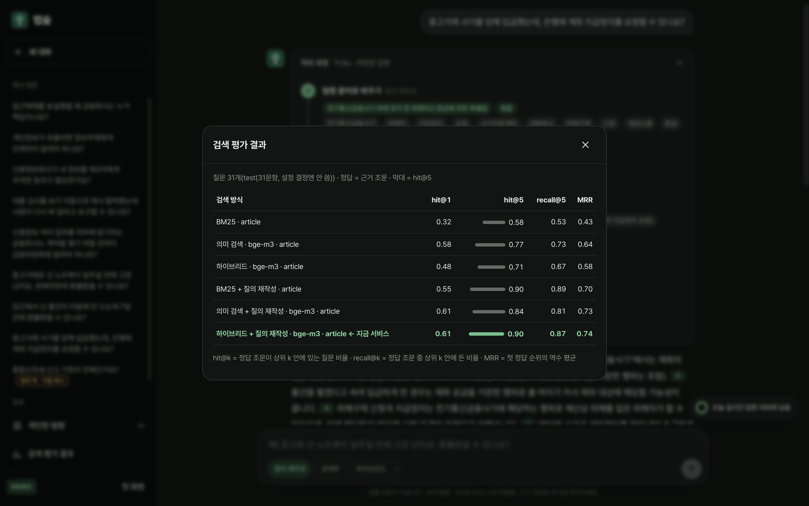

<h1 align="center">법숲 BeopSoop</h1>

<p align="center"><b>일상의 말로 묻고, 법 조문으로 답하는 한국 법령 RAG</b><br>
조문을 찾아 그 안에서만 답하고, 근거가 없으면 답하지 않습니다.</p>

<p align="center">


</p>

<p align="center"></p>

## 주요 기능

- **질의 재작성** - "당근에서 산 게 고장났어요" 같은 일상어를 "하자담보책임 · 해제" 같은 법령 용어로 바꿔 찾습니다.
- **하이브리드 검색** - BM25(문자 bigram) + `bge-m3` 임베딩을 RRF 로 합칩니다. 임베딩은 로컬 CPU(ONNX int8)에서 돌아 외부 임베딩 API 가 필요 없습니다.
- **조문 단위 근거** - 조 단위 청킹, 참조 조문 자동 확장(항을 지정한 참조는 그 항만).
- **지어내지 않는 인용** - 모델은 `[1]..[n]` 번호로만 인용하고 서버가 조문 키로 되돌립니다. 근거가 없으면 `answerable=false`.
- **적응형 에이전트(LangGraph)** - 평소엔 검색 1번 · LLM 1번, "근거 없음"일 때만 근거를 점검하고 새 검색어로 다시 찾습니다.
- **MCP 서버** - `search_law` · `get_article` 도구로 Claude Code 같은 에이전트가 근거를 직접 찾아 씁니다.
- **웹 UI** - 처리 과정(재작성 -> 검색 -> 인용 답변 -> 점검)을 단계별로 보여 주고, 데모 모드(예시 답변 + 하루 상한)를 지원합니다.
- **평가 하네스** - 질문 126개 평가 세트와 hit@k · recall@k · MRR · 충실성 · 거절률 측정 스크립트가 함께 들어 있습니다.

## 성능

test 31문항(설정 결정에 쓰지 않은 질문) 기준입니다. 자세한 내용은 [docs/EVALUATION.md](docs/EVALUATION.md).

| 검색 구성 | hit@5 | MRR |
|---|---|---|
| BM25 | 0.58 | 0.43 |
| bge-m3 임베딩 | 0.77 | 0.64 |
| 하이브리드 | 0.71 | 0.58 |
| **하이브리드 + 질의 재작성 (기본값)** | **0.90** | **0.74** |

| 답변 | 결과 |
|---|---|
| 충실성(받은 근거에 없는 말을 하지 않음) | 31/31 |
| 정확성(정답 조문과 결론 일치) | 30/31 (적응형 에이전트) |
| 범위 밖 질문 거절 | 10/10 |
| LLM 호출 수(한 번 검색 대비) | 1.19배 (매번 점검하는 방식은 2.16배) |

## 빠른 시작

```bash
git clone https://github.com/Nelef/beopsoop.git && cd beopsoop
npm install
npm i -g @anthropic-ai/claude-code      # 답변 · 질의 재작성은 Claude Code CLI(claude -p)로 부릅니다

FINLAW_ALLOW_DEFAULT_LOGIN=1 AUTH_PASS=<비밀번호> node server.mjs
# -> http://localhost:8000 (첫 실행 때 bge-m3 색인을 만드느라 시간이 걸립니다)
```

법령 원문(`data/raw`)은 저장소에 들어 있습니다. 최신 법령으로 다시 받으려면 `node scripts/fetch.mjs`.

**MCP 로 연결**

```bash
claude mcp add finlaw -- node $PWD/mcp/server.mjs
```

**Docker** - `Dockerfile` 은 임베딩 모델 · 색인 캐시(`data/models` · `data/cache`)를 이미지에 넣어 인터넷 없이 돌게 만듭니다. 한 번 로컬에서 실행해 캐시를 만든 뒤 빌드하세요.

## 설정

| 환경 변수 | 설명 | 기본값 |
|---|---|---|
| `PORT` | 웹 서버 포트 | `8000` |
| `AUTH_USER` · `AUTH_PASS` | 로그인 계정(`AUTH_PASS` 를 비우면 로그인 없이 누구나 사용 - 로컬 개발용) | `admin` · 없음 |
| `FINLAW_ALLOW_DEFAULT_LOGIN` | `1` 이면 이 컴퓨터의 Claude Code 로그인으로 답변 | 꺼짐 |
| `FINLAW_CLAUDE_TOKEN` | `claude setup-token` 으로 받은 토큰(위 대신) | - |
| `ALT_LLM_URL` · `ALT_LLM_KEY` | Anthropic 호환 프록시(LiteLLM 등)로 다른 모델 사용 | - |
| `FINLAW_RW_MODEL` · `FINLAW_RRF_W` | 질의 재작성 모델 · RRF 가중(BM25,임베딩) | `sonnet` · `1,1` |
| `DEMO_DAILY_CAP` | 데모 방문자 실시간 답변 하루 상한 | `100` |
| `TELEGRAM_BOT_TOKEN` · `TELEGRAM_CHAT_ID` | 데모 답변이 쓰일 때 알림(선택) | - |

LLM 연결이 없으면 검색 결과만 보여 줍니다. 여러 사람에게 공개 서비스로 운영한다면 각 제공사의 API 이용 조건에 맞는 방식으로 연결하세요.

## 동작 방식

```
질문 ─▶ 질의 재작성(Claude: 일상어 → 법령 용어) ─▶ BM25 ──┐
                                                          ├─ RRF(1:1) ─▶ 상위 5개 조 ─▶ + 참조 조문 ─▶ Claude 답변(JSON: 답 · 인용 번호)
                                    임베딩(bge-m3) ────────┘                                                 근거 없으면 answerable=false
                                                                                                                │
   (LangGraph 적응형) 답이 "근거 없음"일 때만 ─▶ 근거 점검(Claude: 범위 밖인가? 빠진 정보는?) ─▶ 빠졌으면 새 검색어로 한 번 더 찾아 근거를 합친 뒤 다시 답변
```

## 법령 범위

16개 법령(법률 11 · 시행령 5), 2,437개 조문 - 2026-10 현행 기준.

| 영역 | 법령 |
|---|---|
| 금융 · 개인정보 | 전자금융거래법 · 개인정보 보호법 · 신용정보의 이용 및 보호에 관한 법률 (각 시행령) |
| 생활 분쟁 | 민법 · 전자상거래 등에서의 소비자보호에 관한 법률(시행령) · 소비자기본법 · 약관의 규제에 관한 법률 · 소액사건심판법 · 민사조정법 |
| 사기 · 형사 | 형법 · 전기통신금융사기 피해 방지 및 피해자산 환급에 관한 특별법(시행령) |

## 스크린샷

| 첫 화면 | 검색 평가 결과 |
|---|---|
|  |  |

## 한계

- 평가 세트는 LLM 이 조문을 읽고 초안을 쓴 것으로, 사람이 전수 검수하지 않았습니다. test 31문항은 표본이 작습니다.
- 질문과 어휘가 먼 조문(정의 · 권리행사 기간 등)은 놓칠 수 있습니다. 알려진 실패 사례는 [docs/EVALUATION.md](docs/EVALUATION.md#한계--숫자를-읽을-때-주의)에 있습니다.
- 질의 재작성으로 LLM 호출이 한 번 늘어 지연이 생깁니다(재작성 약 2초 + 답변 약 4초).

## 프로젝트 구조

```
server.mjs        웹 UI · API 서버
src/              검색(bm25 · embed · index) · 재작성 · 답변 · 에이전트(agent.mjs) · LLM 호출
mcp/server.mjs    MCP 서버(search_law · get_article)
eval/             평가 세트(qa.jsonl · oos.jsonl) · 측정 스크립트 · 결과
scripts/          법령 수집(fetch.mjs) · 데모 답변 생성(make_demo.mjs)
web/              화면
data/raw/         법령 원문(JSON)
```

## 라이선스

[MIT](LICENSE). `data/raw` 의 법령 원문은 국가법령정보센터 Open API 에서 받았으며, 법령은 저작권법 제7조에 따라 보호받지 않는 저작물입니다.

> 이 프로젝트는 조문 안내이며 법률 자문이 아닙니다. 개별 사건은 변호사 · 대한법률구조공단 등 전문가에게 확인하세요.
